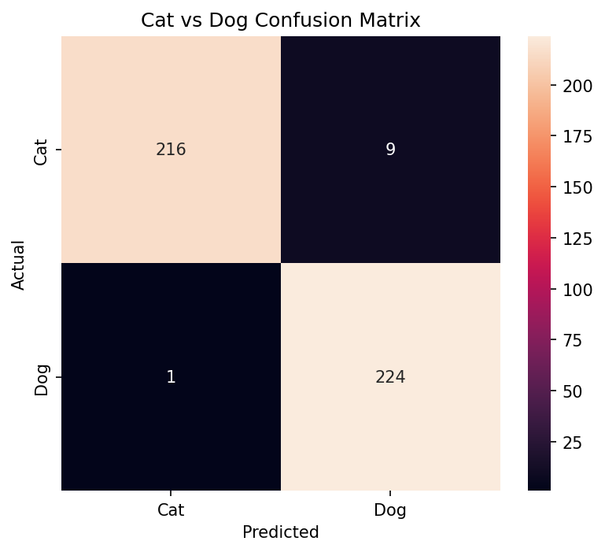
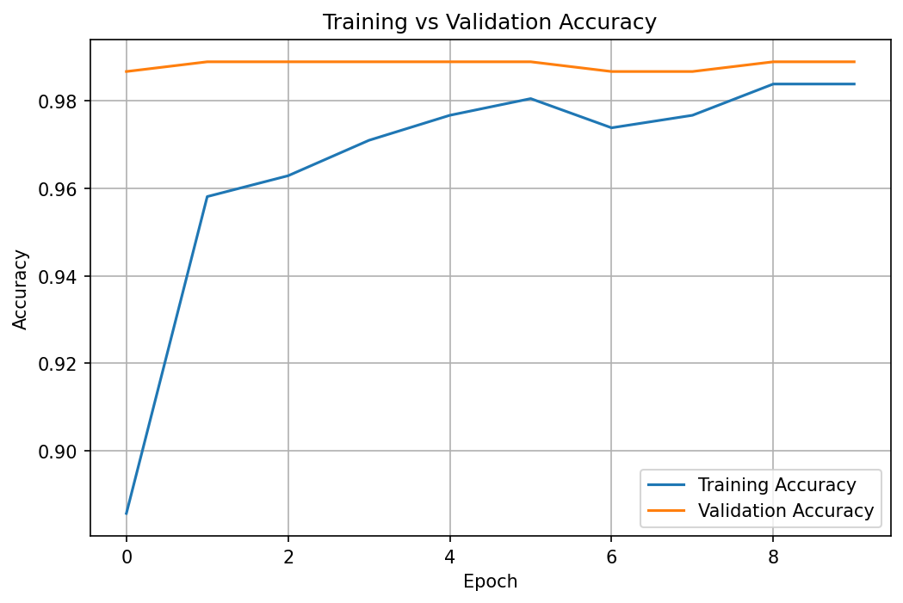
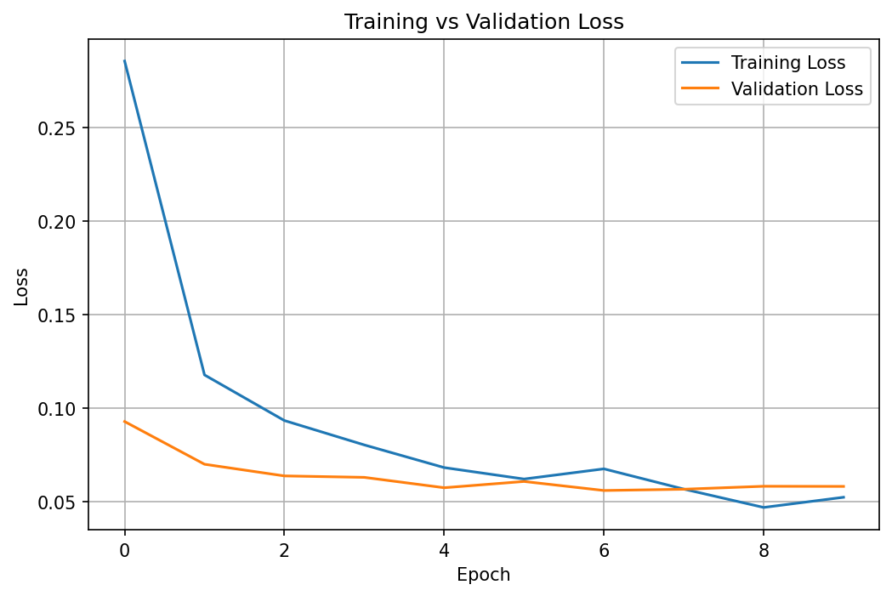
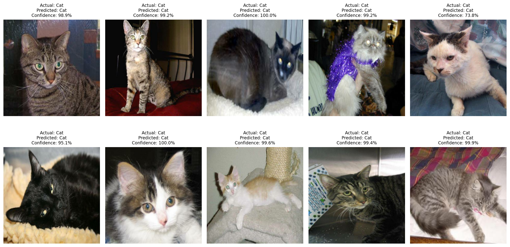

# 🐱🐶 Cat vs Dog Image Classifier

A deep learning image classification project that identifies whether an image contains a cat or a dog.

## Project Overview

This project uses transfer learning with MobileNetV2 to classify cat and dog images.

The model was trained on a balanced dataset of 3,000 images:
- 1,500 cats
- 1,500 dogs

Dataset split:
- Training: 2,100 images
- Validation: 450 images
- Testing: 450 images

## Model

The project uses MobileNetV2, a lightweight convolutional neural network pretrained on ImageNet.

The pretrained layers were frozen and a new classification layer was added for cat/dog classification.

Data augmentation was used during training:
- Horizontal flipping
- Random rotation
- Random zoom

## Results

The model was evaluated on 450 unseen test images.

| Metric | Score |
|---|---:|
| Accuracy | 97.78% |
| Precision | 96.14% |
| Recall | 99.56% |
| F1 Score | 97.82% |

## Confusion Matrix



## Training Results

### Accuracy



### Loss



## Example Predictions



## How to Run

Install the dependencies:

```bash
pip install -r requirements.txt
```

Make sure the trained model is located at:

```text
models/dog_cat_mobilenetv2.keras
```

Run a prediction:

```bash
python predict.py path/to/your/image.jpg
```

Example output:

```text
Prediction: Cat
Confidence: 95.23%
```

## Dataset

The project uses images from the Kaggle Dogs vs Cats competition.

Only a balanced subset of 3,000 images from the training data was used.

## Project Structure

```text
dog-vs-cat-project/
├── README.md
├── predict.py
├── requirements.txt
├── models/
│   └── dog_cat_mobilenetv2.keras
└── results/
    ├── training_accuracy.png
    ├── training_loss.png
    ├── confusion_matrix.png
    ├── example_predictions.png
    └── metrics.txt
```

## Technologies Used

- Python
- TensorFlow / Keras
- MobileNetV2
- NumPy
- Pillow
- Scikit-learn
- Matplotlib
- Seaborn
- Google Colab

## Key Learning

This project helped me understand how transfer learning can be used to build an image classifier without training a deep neural network completely from scratch.